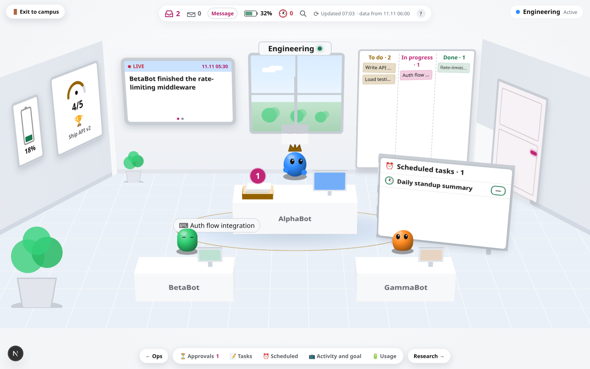

# Control Center

3D control center for a team of AI agents.


*Inside a team room:*



This public demo uses invented names and browser-only simulated actions.
See [LIVE_STATUS.md](LIVE_STATUS.md) for the coordinator status protocol and
[STATUS_PROTOCOL.md](STATUS_PROTOCOL.md) for private deployment notes.

## Features

- **3D campus** (three.js): one room per team, 6 around a central plaza and frozen teams in a
  side wing. Extra teams get generated rooms; the camera re-frames to fit. Orbit/zoom, minimap,
  keyboard shortcuts (`1`–`9` rooms, `]`/`[` next/prev, `/` search, `Esc` back, `?` help).
  SVG fallback when WebGL is missing.
- **Team rooms**: walk in and look around. Lead and member bots at desks, a task board
  (to do / in progress / done), live activity screen, goal gauge, usage battery, scheduled-tasks
  panel with live countdowns and failure alerts.
- **Approvals tray**: approve, reject, or ask about any pending item; queue several and send
  together. In a real deployment they go to the main bot through a webhook.
- **Live status**: coordinator-reported agent statuses with campus badges, team panel indicators,
  and a live activity drawer. Demo mode shows fictional statuses for the seed roster.
- **Live feed & HUD**: in-progress list, approvals window, usage %, next routines,
  "what changed since your last visit".
- **Refresh**: reloads data and (in a live deployment) asks the bot to rebuild it
  (rate-limited to once per 5 minutes), then polls until new data lands.
- Responsive: desktop, foldables, and phones.

## Tech

Next.js 16, React 19, three.js 0.187. No database — data lives in a private
[Vercel Blob](https://vercel.com/docs/storage/vercel-blob) store.

## Setup

### Prerequisites

- Node.js 20+
- A [Vercel](https://vercel.com) account (free plan works)
- A Vercel Blob store (create one in your Vercel project settings → Storage)

### 1. Clone & install

```bash
git clone https://github.com/Amitro123/grok-bot-control-room.git
cd grok-bot-control-room/app
npm install
```

### 2. Environment variables

Copy `.env.example` (in the repo root) and fill in your values:

```bash
cp ../.env.example .env.local
```

| Variable | Purpose |
|---|---|
| `BLOB_READ_WRITE_TOKEN` | Vercel Blob read/write token (from your Blob store) |
| `ADMIN_KEY` | Secret key for the bot data-push endpoint (`POST /api/admin/data` and `/api/admin/status`) |
| `SESSION_SECRET` | Random string used to sign session cookies |
| `CONTROL_ACCESS_TOKEN` | Long random token — your private access link is `/<this-token>` |
| `WEBHOOK_URL` | *(optional)* The bot's webhook endpoint URL |
| `WEBHOOK_KEY` | *(optional)* Sender key for the webhook |
| `WEBHOOK_KEY_HEADER` | *(optional, default `Authorization`)* Header name for the key |
| `NEXT_PUBLIC_TIMEZONE` | *(optional)* IANA timezone, e.g. `America/New_York` (default: viewer's TZ) |

### 3. Run locally

```bash
npm run dev          # http://localhost:3000
# or production build:
npm run build && npm start
```

### 4. Deploy to Vercel

Push this repo to your GitHub, connect it to a Vercel project, add the env vars in the
Vercel dashboard, and deploy. The Blob store must be linked to the project.

### 5. Connect the webhook (optional)

Visit `/setup` (after authenticating) to paste your bot's webhook URL and sender key.
The webhook routine prompt templates are in [`docs/routine-prompts.md`](docs/routine-prompts.md).

### 6. Push data

Use `app/push-data.sh` to upload fresh data without redeploying:

```bash
CC_URL=https://your-app.vercel.app ADMIN_KEY=your-key ./push-data.sh data.json
```

## Project structure

```
app/                   Next.js application
  app/                 App Router pages and API routes
    api/admin/data/    Bot data-push endpoint
    api/admin/status/  Live status push endpoint
    api/data/          Authenticated data read
    api/status/        Authenticated status read
    api/send/          Page → bot webhook relay
    api/setup/         One-time webhook configuration
  components/          ControlCenter, Campus3D, LiveStatus
  lib/                 Auth, config, store, status, theme helpers
  tools/               post-status helper, remove-attribution
  data.json            Seed/fallback data (fictional)
docs/                  Routine prompt templates and refresh procedure
LIVE_STATUS.md         Live status feature overview
STATUS_PROTOCOL.md     Coordinator status reporting protocol
```

## License

MIT — see [LICENSE](app/LICENSE).
