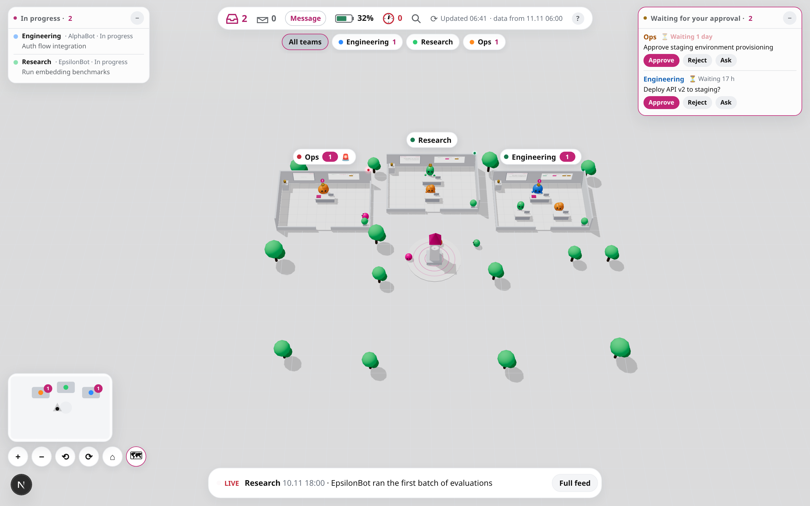

# Grok Bot Control Room

A 3D "mission control" dashboard for a company of AI agents. Every team gets a room on a small
campus — see who is working on what, what is waiting for your approval, which scheduled tasks
run next, how much of the weekly usage each team takes, and send commands back with one click.

Adapted from [sarbarshem/grok-bot-3d-campus](https://github.com/sarbarshem/grok-bot-3d-campus)
(MIT). Built with [Grok Bot](https://grok.com).



## Features

- **3D campus** (three.js): one room per team, 6 around a central plaza and frozen teams in a
  side wing. Extra teams get generated rooms; the camera re-frames to fit. Orbit/zoom, minimap,
  keyboard shortcuts (`1`–`9` rooms, `]`/`[` next/prev, `/` search, `Esc` back, `?` help).
  SVG fallback when WebGL is missing.
- **Team rooms**: walk in and look around. Lead and member bots at desks, a task board
  (to do / in progress / done), live activity screen, goal gauge, usage battery, scheduled-tasks
  panel with live countdowns and failure alerts.
- **Approvals tray**: approve, reject, or ask about any pending item; queue several and send
  together. In a real deployment they go to the main bot through a webhook.
- **Live feed & HUD**: in-progress list, approvals window, usage %, next routines,
  "what changed since your last visit".
- **Refresh**: reloads data and (in a live deployment) asks the bot to rebuild it
  (rate-limited to once per 5 minutes), then polls until new data lands.
- Responsive: desktop, foldables, and phones.

## Tech

Next.js 16, React 19, three.js 0.187. No database — data lives in a private
[Vercel Blob](https://vercel.com/docs/storage/vercel-blob) store.

## Setup

### Prerequisites

- Node.js 20+
- A [Vercel](https://vercel.com) account (free plan works)
- A Vercel Blob store (create one in your Vercel project settings → Storage)

### 1. Clone & install

```bash
git clone https://github.com/Amitro123/grok-bot-control-room.git
cd grok-bot-control-room/app
npm ci
```

### 2. Environment variables

Copy `.env.example` (in the repo root) and fill in your values:

```bash
cp ../.env.example .env.local
```

| Variable | Purpose |
|---|---|
| `BLOB_READ_WRITE_TOKEN` | Vercel Blob read/write token (from your Blob store) |
| `ADMIN_KEY` | Secret key for the bot data-push endpoint (`POST /api/admin/data`) |
| `SESSION_SECRET` | Random string used to sign session cookies |
| `CONTROL_ACCESS_TOKEN` | Long random token — your private access link is `/<this-token>` |
| `WEBHOOK_URL` | *(optional)* The bot's webhook URL for page commands |
| `WEBHOOK_KEY` | *(optional)* Sender key for the webhook |
| `WEBHOOK_KEY_HEADER` | *(optional, default `Authorization`)* Header name for the key |
| `NEXT_PUBLIC_TIMEZONE` | *(optional)* IANA timezone, e.g. `America/New_York` (default: viewer's TZ) |

### 3. Run locally

```bash
npm run dev          # http://localhost:3000
# or production build:
npm run build && npm start
```

Open `http://localhost:3000/<CONTROL_ACCESS_TOKEN>` to set the session cookie, then
navigate to `http://localhost:3000`.

### 4. Deploy to Vercel

Push this repo to your GitHub, connect it to a Vercel project, add the env vars in the
Vercel dashboard, and deploy. The Blob store must be linked to the project.

### 5. Connect the webhook (optional)

Visit `/setup` (after authenticating) to paste your bot's webhook URL and sender key.
This connects the page's buttons to your bot. The webhook routine prompt templates are
in [`docs/routine-prompts.md`](docs/routine-prompts.md) — adapt them to your own bots.

### 6. Push data

Use `app/push-data.sh` to upload fresh data without redeploying:

```bash
CC_URL=https://your-app.vercel.app ADMIN_KEY=your-key ./push-data.sh data.json
```

The data shape is documented in `app/components/ControlCenter.tsx` (the `DataShape` type
and comments at the top).

## Project structure

```
app/                   Next.js application
  app/                 App Router pages and API routes
    [k]/route.ts       Private-link access gate
    api/admin/data/    Bot data-push endpoint
    api/data/          Authenticated data read
    api/send/          Page → bot webhook relay
    api/setup/         One-time webhook configuration
    setup/             Webhook setup page
  components/          ControlCenter (main UI), Campus3D (three.js scene)
  lib/                 Auth, config, store, theme, timezone helpers
  data.json            Seed/fallback data (fictional)
  push-data.sh         Script to push data to the live app
  make-bundle.sh       Bundle helper for Vercel connector deployments
docs/                  Routine prompt templates and refresh procedure
vercel.json            Vercel project config
```

## License

MIT — see [LICENSE](app/LICENSE).

Originally adapted from [sarbarshem/grok-bot-3d-campus](https://github.com/sarbarshem/grok-bot-3d-campus).
